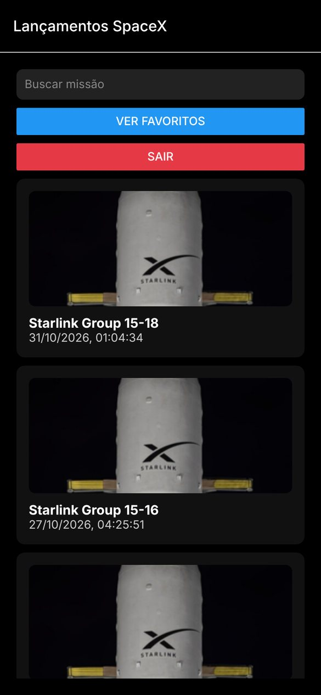
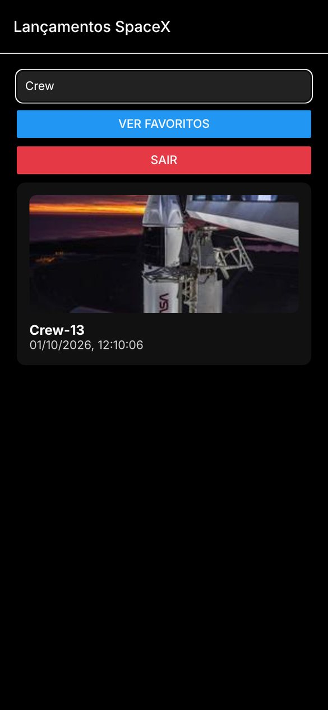
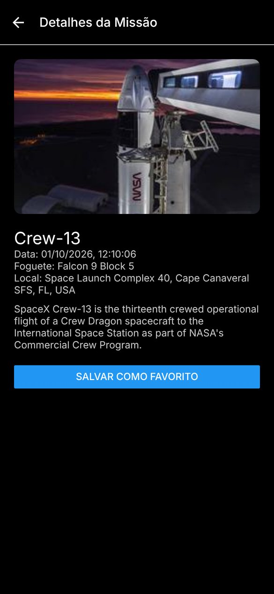
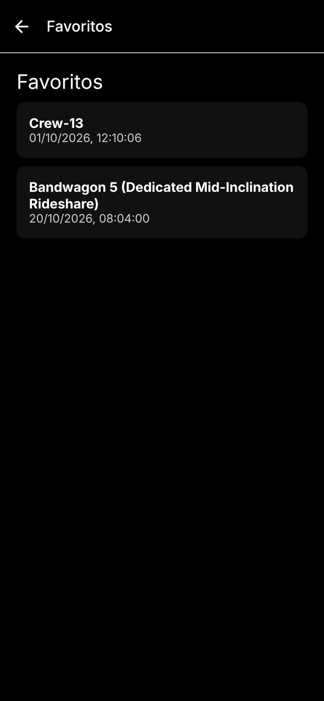

# SpaceX Launches

Mobile app for browsing recent SpaceX launches, built with React Native and Expo. Users create a local account, scroll through the latest launches, search by mission name, open a launch to see the rocket, launch site and mission description, and keep a list of favorites.

The app interface is in Brazilian Portuguese.


## Screenshots

Captured from the web build in a phone-sized window (390x844), with launch data fetched from Launch Library 2 on November 2, 2026.

| Launches | Search | Launch details |
|---|---|---|
|  |  |  |

| Sign-up | Login | Favorites |
|---|---|---|
|  |  |  |

Login, scrolling the list, searching for a crewed mission and saving it as a favorite:


## About

I built this app in August 2025 to practice consuming a REST API in React Native: loading and filtering a list, passing data between screens, and saving per-user data on the device.

It originally used the community r/SpaceX API (api.spacexdata.com). That API stopped responding in 2026, so in November 2026 I moved the app to Launch Library 2 by The Space Devs. Most of that change lives in one service file, which maps the new data to the fields the screens use.

## Features

- Sign-up and login with accounts saved on the device. Each account has its own favorites.
- Launch list with the 50 most recent SpaceX launches, newest first, each with a photo, the mission name and the local date and time.
- Search that filters the list by mission name as you type.
- Launch details: photo, date, rocket, launch site and mission description.
- Favorites: save or remove a launch from its details screen and see the saved ones in their own list.
- Logout back to the login screen.

## How it works

### Data source

[`src/services/spacex.js`](src/services/spacex.js) requests `/launches/previous/` from Launch Library 2 with `lsp__name=SpaceX` and `ordering=-net`, and maps each result to the fields the screens read: `id`, `name` (the mission part of "Falcon 9 Block 5 | Crew-13"), `date`, `image`, `rocket`, `launchpad` and `details`. The list already carries everything the details screen shows, so opening a launch makes no extra requests.

### Cache and rate limit

Anonymous access to Launch Library 2 is limited to 15 requests per hour. The service keeps the last list in AsyncStorage (`launchesCache`) and reuses it for 30 minutes. If a request fails, it falls back to the cached list, even an older one. Only when there is nothing cached does the home screen show an error message instead of the list.

### Accounts and favorites

AsyncStorage holds `usuarios` (the list of accounts), `userAtivo` (the name of the signed-in user) and one `favoritos_<name>` key per user. Favorites saved in the old r/SpaceX API format still open, because `fromStorage()` converts them to the current shape.

### Styling

[`src/components/ui.js`](src/components/ui.js) defines the dark theme components (`Container`, `Input`, `Card`, `CardTitle`) with styled-components. The stack navigator uses black headers to match.

## Limitations

This is a front-end study project:

- Accounts exist only on the device, and passwords are stored in plain text in AsyncStorage.
- Only the 50 most recent launches are loaded, and search filters those 50.
- Many Starlink launches share the same stock photo, because that is the image Launch Library 2 provides for them.
- Error alerts (wrong password, empty fields) use `Alert.alert`, which does not show in the web build.

## Tech stack

- React Native 0.79 and React 19
- Expo SDK 53
- React Navigation 7 (native stack)
- styled-components 6
- Axios
- AsyncStorage
- ESLint with eslint-config-expo

## Project structure

```
.
├── App.js                   # entry point: navigation container
├── app.json                 # Expo config (name, icons, splash)
├── assets/images/           # app icons, splash icon and favicon
└── src/
    ├── components/ui.js     # styled-components for the dark theme
    ├── navigation/index.js  # stack navigator
    ├── screens/             # one file per screen
    ├── services/spacex.js   # Launch Library 2 requests, mapping and cache
    └── styles/colors.js     # color constants
```

Some screen files keep Portuguese names: `CadastroScreen` (sign-up), `LoginScreen`, `HomeScreen` (launch list), `DetailsScreen` and `FavoritesScreen`.

## Getting started

Requires Node.js 20 or newer, plus Expo Go, an Android emulator or the iOS simulator. Launch Library 2 needs no API key.

```bash
git clone https://github.com/PedroRossZny/spacex-launches.git
cd spacex-launches
npm install
npm start
```

`npm start` opens the Expo dev server. Scan the QR code with Expo Go, or press `a` for Android, `i` for iOS or `w` for the browser.

Expo Go from the app stores only runs the latest Expo SDK. If yours is newer than SDK 53, open the app on an Android emulator with `npm run android` (Expo installs a matching Expo Go there) or use the web version.

| Script | What it does |
|---|---|
| `npm start` | starts the Expo dev server |
| `npm run android` | opens the app on an Android emulator or device |
| `npm run ios` | opens the app on the iOS simulator (macOS only) |
| `npm run web` | opens the app in the browser |
| `npm run lint` | runs ESLint |

## Credits

Launch data comes from [Launch Library 2](https://thespacedevs.com/llapi) by The Space Devs. Launch photos belong to their owners, mostly SpaceX, as credited in the API. This project is not affiliated with SpaceX.

## License

The code is released under the [MIT License](LICENSE). Launch data and photos are not covered by it.

## Author

Pedro Ross. [GitHub](https://github.com/PedroRossZny) | [LinkedIn](https://www.linkedin.com/in/pedro-ross)
